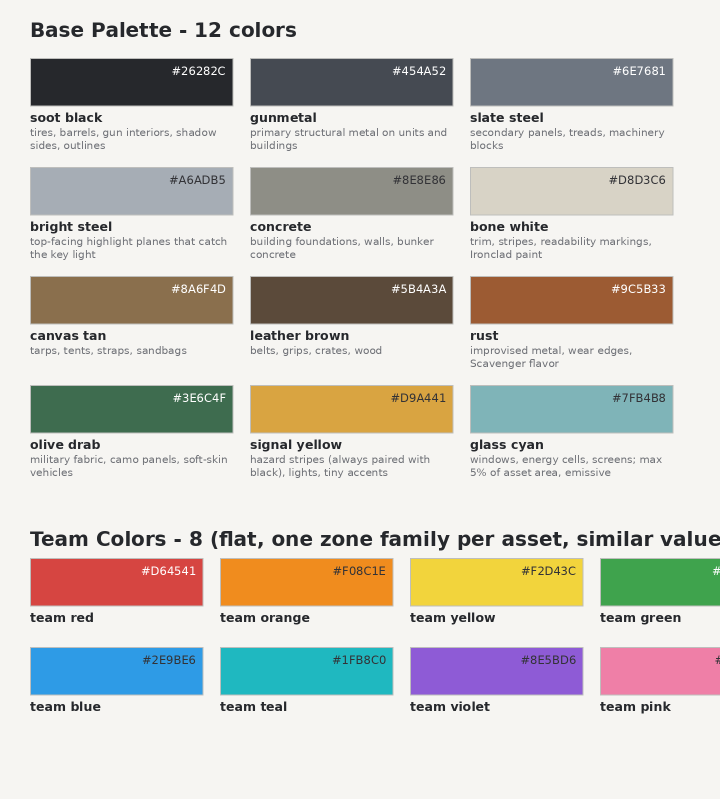
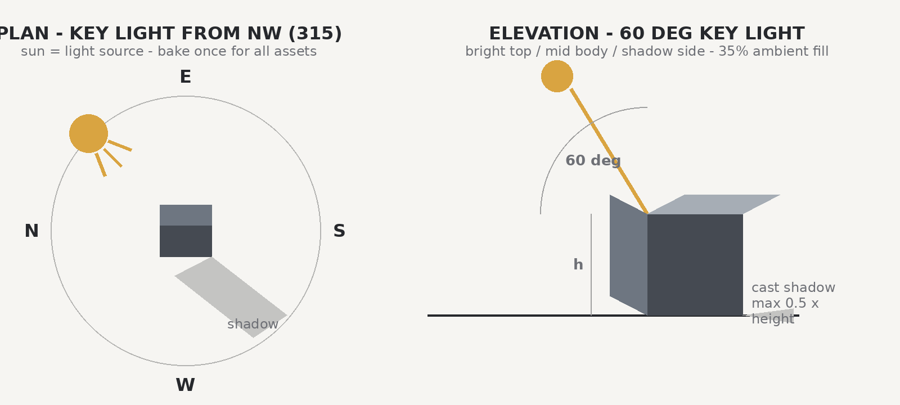
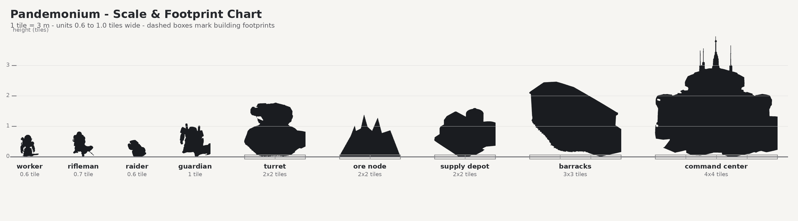
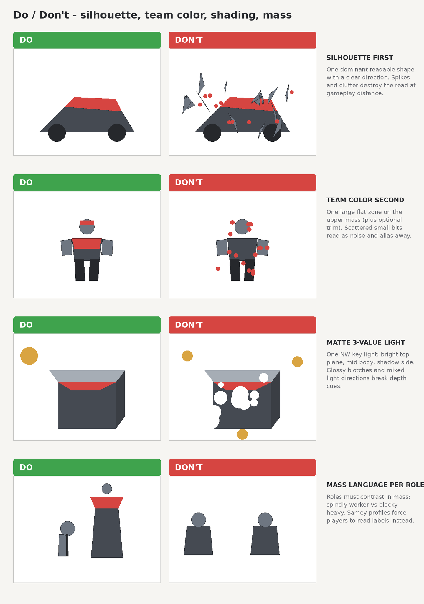

# Pandemonium Art Bible — D-001

**Direction:** readable stylized RTS — **not** realistic.
**Priority order:** silhouette first, team color second, detail last.
Low-poly, matte, readable from a high-angle RTS camera.
The current `tactical_field` textures are an interim look, not the direction.

This file mirrors `art_bible.pdf` (the canonical delivery). Figures reference
files in this directory and in `../roles/`, `../icons/`, `../concepts/`.

---

## 1. Direction and Principles

Pandemonium renders a battlefield from a high-angle RTS camera and every asset
must survive that viewing condition. The direction is a readable stylized look:
low-poly geometry, matte surfaces and bold shapes that resolve instantly at
gameplay zoom. Where a trade-off appears, readability always wins over
fidelity, and fidelity always wins over decoration.

Priority stack:

1. **Silhouette** — the shape alone must identify the role before any color
   or detail is visible.
2. **Team color** — one flat, bright zone communicates ownership at a glance.
3. **Detail** — comes last, only where camera time exists.

Camera: high angle (~55° pitch), near-orthographic feel. **Design top surfaces
first** — roofs, shoulder plates and headgear carry the light, the team color
and the identifying shapes. Fronts and sides are secondary; undersides are
almost never seen.

Readability budget:

- Every unit and building must be identifiable from its silhouette alone in a
  48×48 px thumbnail (`../roles/role_chart_48px.png` is the acceptance test).
- One dominant shape per asset; secondary protrusions never compete with it.
- Team color is one flat zone family per asset, always in the same location
  family.
- Matte surfaces with 3-value shading. Nothing gleams, nothing blooms.
- If a feature vanishes at 48 px it belongs to the D-002 model pass, not the
  gameplay read.

## 2. Color System

One fixed palette: **12 base colors + 8 team colors** (`palette.json`,
`palette.gpl`). Bodies stay desaturated so team colors pop without glow
effects, and recolor passes never touch the underlying materials.

Area discipline (approximate): 60% body neutrals, 25% secondary materials,
10–15% team color, <5% accents.

Team-color rules:

- One **primary zone** on the upper mass (shoulders / roof / mantlet) plus at
  most one secondary trim.
- Never on thin parts that alias away (antennas, barrels, struts), never as
  scattered specks.
- All 8 team colors share a narrow value band — no player is brighter.
- Color-vision-deficiency fallback: per-team emblems / trim patterns (finalized
  with the client UI in D-002).

| Kind | Primary team-color zone |
|---|---|
| worker | hard hat + backpack shell |
| rifleman | torso vest + helmet band |
| raider | engine cowl |
| guardian | shoulder mantlet plates |
| command_center | roof disc + door frame |
| barracks | gable roof panels |
| supply_depot | silo dome caps |
| turret | mantlet ring |

Accent discipline: `signal_yellow` is a hazard color and always appears
striped with soot black (keeps it distinct from team yellow). `glass_cyan` is
the only emissive material, ≤5% of asset area, marking function only.

## 3. Material Language

| Material | Finish | Wear rules | Notes |
|---|---|---|---|
| Painted team plate | flat, gloss 0–5% | no chipping inside team zones | ownership surface; recolor stays trivial |
| Bare construction metal | gunmetal, matte | edge wear on handling edges only | primary structure color |
| Rubber / tires | near-black, zero gloss | none | wheels, tracks, grips |
| Canvas / tarp | tan, zero gloss | big soft folds only | low-poly friendly; Scavenger signature |
| Rust / scrap | rust accent, matte | patchy plate borders | improvised look; Scavengers |
| Glass / energy | emissive cyan | none | ≤5% area; function beacons only |
| Concrete | flat, faint tint variance | hairline cracks at most | foundations, walls |
| Wood / crate | leather brown | plank gaps | supply visuals |

Forbidden: chrome or mirror finishes, specular bloom / HDR glints,
procedural grime noise at gameplay scale, alpha-decal clutter, glossy team
paint. Nothing may be shinier than its neighbors.

## 4. Lighting

One baked key light, identical for every asset and faction:

- Key: **azimuth 315° (from NW), elevation 60°**, warm-neutral white.
- Fill: cool sky ambient ≈35%. Ground bounce: warm ≈10%, downward faces only.
- Shading: **3 values** — bright top plane, mid body, shadow side.
- Cast shadows: soft, **max 0.5× asset height**, always toward SE.
- No rim lights, no colored spotlights, no per-faction lighting moods.

## 5. Silhouette Rules per Role

| Role | Mass language | Protrusions | Signature element |
|---|---|---|---|
| Worker | small, hunched, asymmetric | many small, harmless | oversized tool arm + backpack |
| Infantry | slim vertical figure | one: the rifle line | rifle held out horizontally |
| Fast raider | long, low horizontal wedge | few, swept back | pointed nose, exposed wheels |
| Heavy | tall and wide boulder | few and blunt | huge shoulder mantlet, small head |
| Defense | static pedestal + gun axis | one: the barrel | octagon base with long barrel |
| Headquarters | tallest landmark | vertical spire | antenna mast visible from anywhere |
| Production | long horizontal barn | one: the bay door | big door things emerge from |
| Supply | low chunky stack | repeated module bumps | paired silos and crates |

The current eight kinds demonstrate the grammar — each pair below shows the
high-angle concept render next to its silhouette-only version (both must read
as the same role; red is the demonstrative team color):
`../roles/worker.png` … `../roles/turret.png` with `_silhouette` variants.

Acceptance test: `../roles/role_chart_48px.png`. If a playtester cannot name a
new unit from its 48 px silhouette alone, the silhouette is rejected.

## 6. Scale and Footprints

**1 tile = 3 m.** Units are deliberately oversized (~1.5× real-world) so they
stay visible at RTS zoom. Widths are collision diameters; buildings occupy
exact tile rectangles.
Widths mirror the game's content data (`content/entities/*.ron`, re-derived
2026-10-25 — rifleman 0.7, raider 0.6; corrected in D-002).

| Kind | Footprint | Size class | Height (tiles) |
|---|---|---|---|
| worker | 0.6 tile wide | S | 0.5 |
| rifleman | 0.7 tile wide | S | 0.7 |
| raider | 0.6 tile wide | M | 0.4 |
| guardian | 1.0 tile wide | L | 1.2 |
| command_center | 4×4 tiles | XL | 3.0 |
| barracks | 3×3 tiles | L | 1.2 |
| supply_depot | 2×2 tiles | M | 0.9 |
| turret | 2×2 tiles | M | 1.5 |
| ore_node | 2×2 tiles | M | 0.8 |

Heights form a strict ladder: workers < 0.5 tiles, combat units 0.5–1 tile,
turret barrel tip 1.5 tiles, command center 3 tiles. Nothing buildable exceeds
the command center.

## 7. Do / Don't

- **Do** keep one dominant shape with a clear direction; **don't** scatter
  equal-size protrusions that erase the read.
- **Do** place one large flat team zone on the upper mass; **don't** sprinkle
  small colored bits that alias into noise.
- **Do** shade in three values from the single NW key; **don't** mix light
  directions or add glossy blotches.
- **Do** exaggerate mass contrast between roles; **don't** let a worker and a
  heavy share a profile.
- **Do** desaturate bodies so team color pops; **don't** let faction materials
  compete with ownership color.

## 8. Faction Languages

Factions share palette, lighting and readability rules; they separate through
**silhouette language and material weighting**. The base army is the reference:
clean, industrially manufactured, symmetric.

**Scavengers** — cheap, fast, improvised; weak buildings. Jagged, asymmetric
silhouettes: mismatched plates, exposed wheels, tarps and pipes. Materials
weighted to rust, canvas tan, worn tires. Buildings look thin and temporary
(scaffolding, container stacks, tarp doors). Roster: `salvager`, `ratter`,
`scrap_hound`, `ram`, `scrap_yard`, `garage`, `stash` — boards in
`../concepts/scavengers/`, silhouette roster in `lineup.png`.

**Ironclad** — heavy, slow, expensive; strongest static defense. Monolithic
slab language: thick symmetric riveted plating, fortress architecture, steam
vents. Materials weighted to gunmetal and bone white with brass fittings.
Buildings are bunkers: thick walls, star-fort angles, embedded guns. Roster:
`artificer`, `legionnaire`, `crawler`, `colossus`, `citadel`, `forge`,
`bastion` — boards in `../concepts/ironclad/`.

Concept-board conventions: front / side / top views of one consistent design;
team-color zones marked in the faction's demonstrative color (orange for
Scavengers, blue for Ironclad) with a legend; SPEED / MASS / COST tier chips.

## 9. Delivery Conventions

- Filenames are **snake_case and match kind ids** exactly as the existing pack
  does (`rifleman.png`, never `Rifleman_v2.png`). No version suffixes.
- Icons: 128×128 PNG, RGBA, transparent background; 512 px masters in
  `icons/512/`. Set preview: `../icons/preview.png`.
- Role renders: `roles/<kind>.png` (as generated, studio background) and
  `roles/<kind>_silhouette.png` (transparent).
- Repo limits: PNGs ≤2048×2048 and ≤64 MiB (client loader); D-001 files
  ≤25 MB each.
- Layered sources (`.blend`, `.psd`) are **not** committed yet — Git LFS will
  be set up first; large sources go through the PM.
- The technical asset spec (model format, poly budget, axes, export scale)
  arrives in **D-002** once the model pipeline exists.
